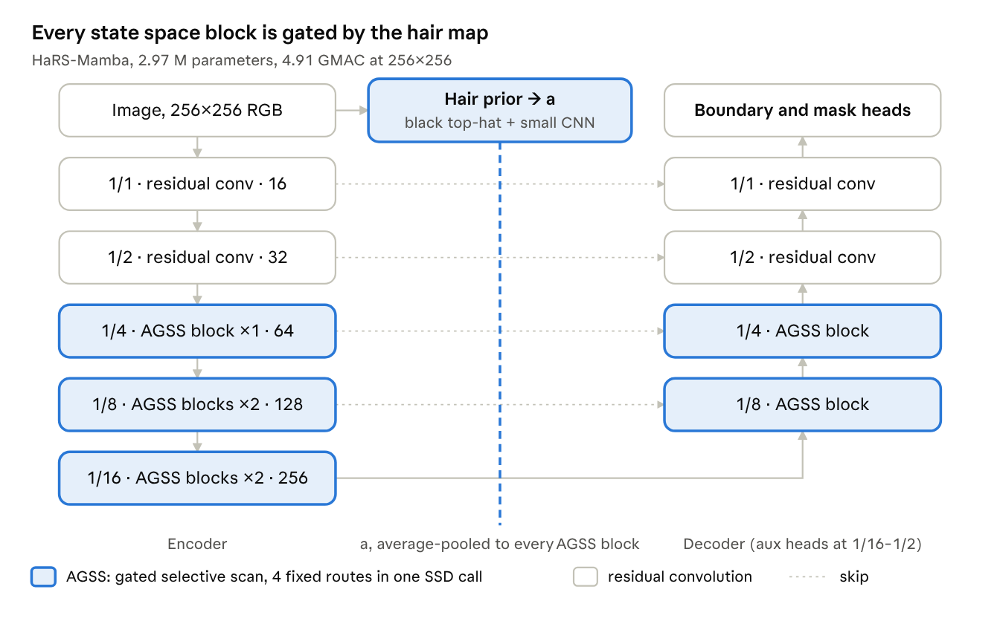

# HaRS-Mamba

**HaRS-Mamba: A Hair-aware Robust Scanning State Space Model for Dermoscopic Skin Lesion Segmentation**

Fırat ÖZCAN — Department of Mechatronics Engineering, Faculty of Technology, Kırklareli University, Kırklareli, Turkey

HaRS-Mamba is a hybrid CNN–Mamba U-Net for dermoscopic lesion segmentation. Its core component, the
**artifact-gated selective scan (AGSS)**, estimates a per-pixel hair probability with a morphological prior
and a small CNN (trained only on synthetic hair) and uses it to shrink the step size Δ of every state space
layer, so that the scan steps over occluded tokens instead of writing them into the recurrent state:

```
Δ'_{t,h} = max( Δ_{t,h} · (1 − σ(β_h) · a_t), 1e-4 )
```

All scan routes of a layer are evaluated in a single Mamba-2 state space duality (SSD) call written in
plain PyTorch, so no `mamba_ssm`, Triton or custom CUDA kernels are needed.

## Results (official ISIC 2018 Task 1 test set, 1,000 images, 256×256)

| Setting | Dice | IoU |
|---|---|---|
| Fold models (5-fold CV, mean ± SD) | 0.8891 ± 0.0043 | 0.8191 ± 0.0067 |
| 5-model ensemble | 0.8980 (95% CI 0.8904–0.9051) | 0.8303 |
| 5-model ensemble + flip TTA | 0.8988 | 0.8313 |

2.97 M parameters, 4.91 GMAC (256×256). Checkpoints were selected on the held-out fold of the official
training + validation images only; the test set was not used for training or checkpoint selection.

Ablation (ensemble Dice): HaRS-Mamba 0.8980 · without synthetic hair 0.8951 · without AGSS 0.8919.
Full tables: [`results/ablation_tables.md`](results/ablation_tables.md).

## Repository layout

```
hars/                 model package
  model.py            HaRS-Mamba U-Net (sizes: tiny, base, large)
  blocks.py           AGSS mixer (multi-route, single SSD call), hybrid block
  artifact.py         hair prior (black top-hat + small CNN)
  ssd.py              Mamba-2 SSD scan in plain PyTorch (float32)
  scans.py            fixed cross-scan routes
  data.py             dataset, augmentation, synthetic hair
  losses.py           BCE + Dice, deep supervision, boundary and hair terms
  metrics.py          image-wise and dataset-wise metrics
prepare_data.py       resize ISIC 2018 once into a 256 px PNG cache
make_folds.py         5 stratified, near-duplicate-grouped folds (results/folds/)
train_fold.py         train one fold (early stopping, NaN guard, resumable)
evaluate_folds.py     test-set evaluation of the 5 fold models, ensemble, TTA, original resolution
paper_stats.py        bootstrap CIs, paired tests, hair-map statistics, speed
compare_variants.py   ablation tables (Tables 5–6) and the hair-heavy subset
run_experiments.py    runs everything above in order
selftest.py           CPU checks: SSD == recurrence, Δ = 0 skips a token, routes, model, loss
model_summary.py      parameters and MACs
results/              fold assignments and all per-image results reported in the paper
weights/              trained HaRS-Mamba checkpoints, one per fold (see weights/README.md)
figures/              figures of the paper (Fig. 1–6) and supplementary figures
```

## Installation

```bash
git clone https://github.com/frtozcan/HaRS-MAMBA.git
cd HaRS-MAMBA
# install PyTorch for your platform first (https://pytorch.org), then:
pip install -r requirements.txt
python selftest.py
```

## Reproducing the experiments

1. Download ISIC 2018 Task 1 (training, validation and test images and masks) from
   https://challenge.isic-archive.com/data/ into `data/ISIC2018/` (folders or the original zip files).
2. Build the 256 px cache:
   ```bash
   python prepare_data.py --root data --dataset isic2018 --size 256 --cache data/cache
   ```
3. Train and evaluate (the fold assignments in `results/folds/folds.json` are used as released;
   `python make_folds.py` regenerates them):
   ```bash
   python run_experiments.py                 # HaRS-Mamba and both ablations
   # or step by step
   python train_fold.py --fold 1             # repeat for folds 1–5
   python evaluate_folds.py --name hars_mamba
   python paper_stats.py --name hars_mamba
   ```
   Data and output folders can be changed with the environment variables `HARS_DATA` (default `./data`)
   and `HARS_RUNS` (default `./runs`).

Training settings: AdamW (lr 1e-3, weight decay 1e-2), 5-epoch warm-up and cosine decay, batch size 8,
at most 200 epochs with early stopping (patience 40, never before epoch 60), mixed precision except the SSD
scan, seed 42 + fold index. One fold takes about 3–4 h on an RTX 2080 Super Max-Q laptop GPU.

## Pretrained weights

`weights/hars_mamba_fold{1..5}.pt` are the five fold models of the paper (12 MB each), each selected on its
held-out fold. Quick use:

```python
import torch
from hars import build_model

ck = torch.load("weights/hars_mamba_fold1.pt", map_location="cpu")
model = build_model("base")
model.load_state_dict(ck["model"])
model.eval()
logits = model(x)["seg"]          # x: (B, 3, 256, 256), ImageNet-normalised RGB
```

To reproduce Table 2 (single models, ensemble, TTA) without training, copy the checkpoints to
`$HARS_RUNS/hars_mamba/fold_k/best.pt` and run `python evaluate_folds.py --name hars_mamba`.

## Figures

| File | Content |
|---|---|
| `figures/fig1_architecture.png` | Fig. 1 — architecture |
| `figures/fig2_training_curves.png` | Fig. 2 — training loss and held-out-fold Dice |
| `figures/fig3_dice_distribution.png` | Fig. 3 — per-image test Dice |
| `figures/fig4_dice_by_lesion_size.png` | Fig. 4 — ensemble Dice by lesion size |
| `figures/fig5_worst_cases.png` | Fig. 5 — the eight test images with the lowest ensemble Dice |
| `figures/fig6_hair_maps.png` | Fig. 6 — hair probability maps |
| `figures/figS1_test_dice_per_fold.png` | test Dice of each fold model and the ensemble |
| `figures/figS2_best_cases.png`, `figS3_median_cases.png` | best and median test cases |



## Released results

`results/` contains everything needed to check the numbers in the paper without retraining:

* `folds/` — fold assignments (`folds.json`), per-fold statistics and the near-duplicate groups;
* `hars_mamba/` — per-fold training logs, test metrics and per-image test results, ensemble results
  (256 px, flip TTA, original resolution) and summary statistics;
* `no_synthetic_hair/`, `no_agss/` — the ablation variants;
* `hair_heavy_scores.csv` — the model-independent hair score of each test image.

`python compare_variants.py --root results` rebuilds the ablation tables from these files.

## Citation

The paper is under review. Citation details will be added after publication.
